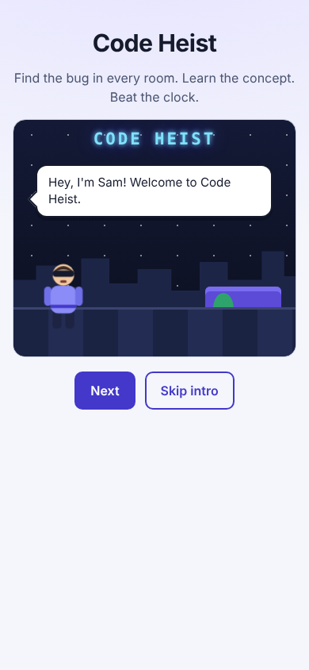
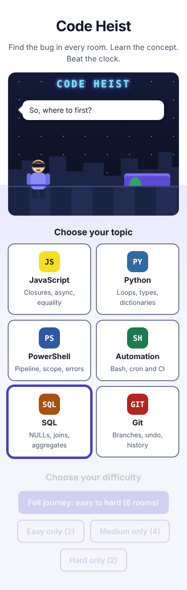
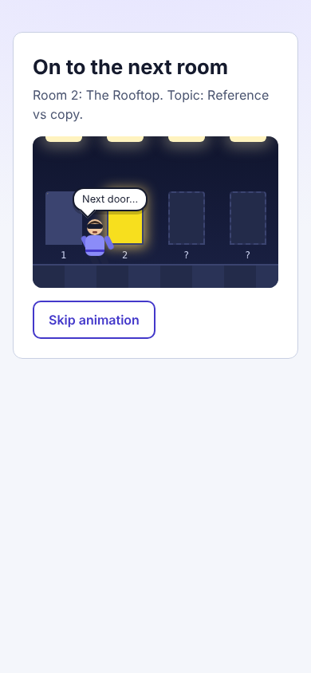
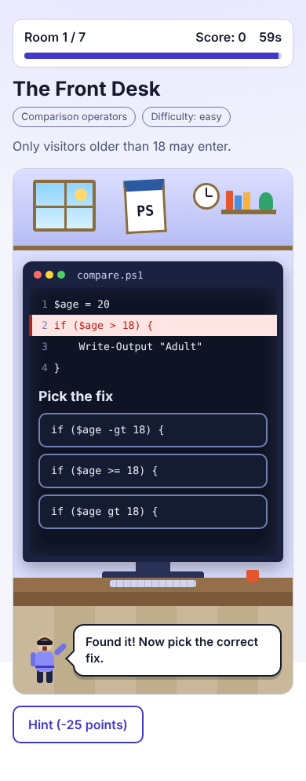

# Code Heist

A bug-fixing escape game for students and developers. Sam, your masked guide, welcomes you and walks you through a building of locked rooms. Every room has a computer with buggy code on its monitor: find the buggy line, pick the correct fix, learn the concept behind it, and beat the clock.

**Play online:** https://matancohen1205.github.io/Code-heist/



- **Six topics, 70+ rooms, each topic easy to hard:** JavaScript, Python, PowerShell, Automation (Bash, cron, CI), SQL and Git, with at least four rooms in every tier. Play the full journey or a single tier. The game never says how many rooms are ahead: doors in the corridor show "?" until you reach them.
- **Real bug patterns:** off-by-one, `var` closures, `is` vs `==`, PowerShell scope and `>` redirection, unquoted shell variables, the cron `%` trap, `NOT IN` with NULLs, detached HEAD and more.
- **Story-driven animation:** Sam talks in speech bubbles, walks the corridor to each door, and enters a themed office room for every question.
- **Study summary:** the results screen explains every concept you practiced.
- **Accessible:** keyboard friendly, light and dark themes, screen reader announcements, skip buttons, and full `prefers-reduced-motion` support.

| Choose a path | Walk to the door | Solve it on the monitor |
|---|---|---|
|  |  |  |

Built with React, TypeScript and Vite. No backend required.

## Play locally

```bash
npm install
npm run dev     # start the dev server
npm test        # run unit tests
npm run build   # type-check and build
```

## Architecture

The code follows single-responsibility and strict layer separation: UI never contains game rules, and game rules never import React.

```
├── src/
│   ├── components/      # UI only: renders props, emits callbacks
│   │   ├── scene/       # Player, SpeechBubble, LobbyScene, RoomScene, Monitor
│   │   ├── common/Button.tsx
│   │   ├── IntroScreen.tsx, PathPicker.tsx   # welcome dialogue + topic/tier choice
│   │   ├── CorridorScreen.tsx                # animated walk to the next door
│   │   ├── RoomScreen.tsx, CodeViewer.tsx, FixOptions.tsx, HUD.tsx
│   │   └── ResultScreen.tsx
│   ├── core/            # pure business logic, framework-free
│   │   ├── engine/      # gameReducer (state machine), checkAnswer
│   │   ├── scoring/     # calculateScore, ranks
│   │   ├── levels/      # one file per topic + index.ts (registry, tiers, file names)
│   │   ├── story/       # dialogue lines spoken by the guide
│   │   └── types.ts
│   ├── hooks/           # useGame, useTypewriter, usePrefersReducedMotion
│   ├── services/storage.ts # localStorage access (best score)
│   └── styles/          # design tokens, global, scenes, animations
├── tests/               # reducer tests and level data-integrity tests
├── tools/verify-levels/ # runs every puzzle against all its answers
└── public/              # social preview image and favicon
```

## Accessibility

- Every interaction is a real button, fully keyboard operable.
- Visible focus ring, 44px touch targets, light and dark themes via design tokens.
- The guide's feedback is announced through `aria-live` regions; the timer is exposed as a progressbar.
- Decorative scenery is hidden from assistive tech; the guide's lines and the destination are announced as text.
- Respects `prefers-reduced-motion`: scenes are skipped and animations are disabled.
- Audited with axe-core in light and dark themes: no violations.

## Are the puzzles actually right?

Every room claims exactly one correct fix. `npm run verify:levels` checks that by running the code: JavaScript with Node, Python, Bash, SQL on SQLite, and Git commands in throwaway repositories. For each room it runs the original and every fix option, and fails if anything other than the declared fix produces the expected behaviour. It caught two ambiguous rooms during development.

Limits: PowerShell rooms are not executed (no runtime in the dev environment) and cron and GitHub Actions rooms are checked by rule and by parsing, not by running a scheduler.

## Adding a room or a topic

Add an entry to a file in `src/core/levels/` with the snippet, the buggy line index, fix options, topic, difficulty and explanation. The data-integrity tests in `tests/levels.test.ts` catch mistakes such as a wrong line index, a missing correct fix, or a tier with fewer than four rooms. Then run `npm run verify:levels` to prove the answer is unique. To add a new topic, create a level file, register it in `src/core/levels/index.ts`, and add a colour theme in `src/styles/scenes.css`.

Each bug must be fixable by replacing a single line.
